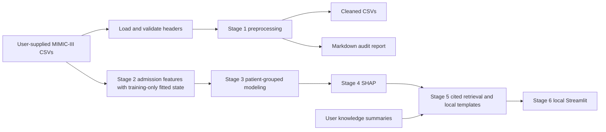

# Clinical risk prediction with a grounded explanation assistant

Stage 1 implements loading and descriptive preprocessing for the MIMIC-III Clinical Database DEMO. The project keeps a hospital-mortality (`hospital_expire_flag`) model, explains its predictions with SHAP, and grounds plain-language explanations in retrieved literature. It also includes a separate prolonged-hospital-stay (7+ days) soft-voting ensemble, without changing the mortality model. All six implementation stages are present and tested. Stage 5 currently uses explicitly marked placeholder knowledge files, so medical-literature validation is pending. The local Streamlit app displays both current scores, mortality SHAP charts and cited explanations.



## Setup and run (PowerShell)

Open a terminal in this repository (`healthcare-risk-rag`). Python 3.10+ is required. pandas was approved for Stage 1; pytest is the test runner. Transitive dependencies are installed automatically. Stages 1 and 2 use pandas, pytest and the Python standard library. Stage 3 adds the user-approved scikit-learn and matplotlib packages and the requested XGBoost. Stage 4 adds SHAP; Stage 5 adds sentence-transformers and FAISS CPU; Stage 6 adds the requested Streamlit interface. Their numerical/runtime dependencies install automatically.

```powershell
python -m venv .venv
.\.venv\Scripts\python.exe -m pip install -r requirements.txt
.\.venv\Scripts\python.exe -m pytest -q
.\.venv\Scripts\python.exe -m src.preprocessing
.\.venv\Scripts\python.exe -m src.features
.\.venv\Scripts\python.exe -m src.train
.\.venv\Scripts\python.exe -m src.prolonged_stay
.\.venv\Scripts\python.exe -m src.explain
.\.venv\Scripts\python.exe -m src.rag --download-model
```

The first two commands create an isolated environment and install dependencies. The third runs the tests. The fourth reads your data, prints the before/after report, saves seven lowercase CSVs in `data/processed/`, and writes `reports/preprocessing_report.md`. The fifth command creates the Stage 2 feature files and feature report. The sixth trains and evaluates the mortality models. The seventh creates the separate prolonged-stay soft-voting ensemble. The eighth explains the saved mortality model and writes SHAP reports and plots. The ninth runs Stage 5; --download-model permits the one-time download of pretrained embedding weights. Later runs can omit this flag and use cached weights locally. Activation is unnecessary. Paths are relative to the repository root, and all path handling uses pathlib.

Optional path overrides:

```powershell
.\.venv\Scripts\python.exe -m src.preprocessing --raw-dir data/raw --output-dir data/processed --report reports/preprocessing_report.md
```

The command stops with exit code 1 and a complete missing-file list if any input is absent. It does not fabricate a dataset, download data, or create a misleading preprocessing report. Existing generated outputs are not updated on input-validation failures. Successful runs overwrite the cleaned CSVs and report.

## Supply the dataset

Place your authorized MIMIC-III Clinical Database DEMO files directly under `data/raw/`:

```text
PATIENTS.csv
ADMISSIONS.csv
ICUSTAYS.csv
DIAGNOSES_ICD.csv
LABEVENTS.csv
D_LABITEMS.csv
PRESCRIPTIONS.csv
```

Names are case-insensitive; `.csv.gz` is also accepted. Supply one file per table. Keep the original CSV headers; the loader strips surrounding whitespace and lowercases them. Missing required join/target columns produce an error showing the actual headers. The local workspace now contains your supplied CSVs; the distributable ZIP excludes them. Data and generated reports are gitignored; keep them out of GitHub.

## Major files

| File or directory | Purpose |
|---|---|
| `src/data_loading.py` | Locate all seven tables, normalize headers, validate required columns, preserve identifier/code strings and leading zeroes. |
| `src/preprocessing.py` | Pure copying cleaner and command-line runner; parses dates, normalizes text, computes admission age, deduplicates, prunes columns, imputes labs/categories, prints and saves the audit report. |
| `tests/test_stage1.py` | Isolated unit tests, schema-only integration test, and missing-data failure test. Tiny in-memory test fixtures are never saved as a project dataset. |
| `requirements.txt` | Bounded minimum versions for pandas and pytest; no later-stage packages. |
| `pyproject.toml` | pytest test discovery and import settings. |
| `.gitignore` | Excludes raw/processed data, generated reports, environments and caches. |
| `data/raw/` | Your input CSVs. |
| `data/processed/` | Cleaned output CSVs after a successful run. |
| `reports/` | Generated preprocessing report after a successful run. |
| `notebooks/01_understanding_ehr.ipynb` and `02_cleaning.ipynb` | Stage 1 notebook entry points; use the tested source modules. |
| `src/features.py` | Stage 2 admission aggregation, training-only lab selection/imputation/scaling, JSON state and CLI. |
| `tests/test_stage2.py` | Patient separation, leakage exclusion, training-only fitting, counts, aggregation, state reload and CLI tests. |
| `src/train.py` | Stage 3 patient-separated holdout, grouped CV, fold-specific preprocessing, three models, metrics, plots and saved bundles. |
| `tests/test_stage3.py` | Tests metrics, class balance, grouping, train-only encoding/fitting, model serialization and plots. |
| `models/` | Fitted training-only bundles plus selected-model manifest; generated files are gitignored. |
| `src/explain.py` | Stage 4 selected-model loader, probability-space SHAP, readable top-five factors, global plots and explanation CLI. |
| `tests/test_stage4.py` | SHAP shapes/class selection, additivity, grouping, original-unit values, missing values, model fallback and artifact tests. |
| `src/rag.py` | Stage 5 source metadata/chunking, local embeddings, cached FAISS retrieval, cited templates and optional validated HTTP provider. |
| `tests/test_stage5.py` | Retrieval, chunk provenance, cache invalidation, placeholder handling, citation validation and provider rejection/fallback tests. |
| `data/knowledge/` | Five clearly marked placeholder files plus instructions for replacing them with reviewed open-access summaries. |
| `.env.example` | Optional provider configuration example; set environment variables yourself (no dotenv loader). |
| `app/app.py` | Stage 6 patient/admission selectors, score cards, live SHAP chart, factor table, source passages and JSON download. |
| `src/app_service.py` | Session-local model/knowledge services, frozen inference, cached-record provenance checks and input invalidation. |
| `tests/test_stage6.py` | Backend tests plus Streamlit AppTest interactions, setup failures, retrieval degradation and UI text checks. |
| `.streamlit/config.toml` | Loopback-only local server, light theme and disabled usage telemetry. |
| `START_HERE.md` | Short setup/launch/use guide. |
| `VALIDATION.md` | Actual test and integration results for all six stages, including the placeholder-only knowledge limitation. |

## Stage 1 decisions

- Parse `admittime`, `dischtime`, `deathtime`, `intime`, `outtime`, `dob`, and other known MIMIC date columns. Malformed nonempty dates fail clearly instead of silently becoming missing.
- Strip text and uppercase it. Whitespace-only values become missing. Textual categories use `UNKNOWN`, never the mode. Identifiers are not filled with a fabricated category.
- Compute age in completed calendar years at admission. Shifted ages in the 300s cap at 90; negative ages and absent birth/admission dates remain missing. Calendar arithmetic avoids timestamp-subtraction overflow. Conflicting birth dates for a patient cause an error.
- Remove duplicate rows before estimating medians. Remove columns with strictly more than 60% missing and constant columns. Preserve join keys, the target, numeric lab values and age even if sparse or constant, so tables remain linkable and the label is retained. Reports list removed columns. A single-valued category such as gender can therefore be removed on a small subset.
- Impute `labevents.valuenum` by median within `itemid`. Groups with no observed numeric values and rows missing `itemid` stay missing. Other numeric/date columns are not imputed. Removing a sparse date column does not prevent age computation because age is computed first.
- Repeat duplicate/column cleanup as needed to reach a stable result. Reapplying preprocessing preserves cleaned tables; reports describe the inputs to each particular call and naturally differ across calls.
- No random operations occur in Stage 1. Use `random_state=42` when later randomized stages are implemented.

## Validation and stage gate

See `VALIDATION.md` for the actual run. Stage 1 has now succeeded on the supplied dataset: 100 patients, 129 admissions, all seven tables processed, and real-data idempotence verified. The report is saved in `reports/preprocessing_report.md`. Unit-test fixtures exercise algorithms without inventing a substitute dataset. Stage 2 has now also succeeded on the supplied CSVs; its results are recorded below.

Stage 2 now tests patient separation and exclusion of explicit outcome fields. Its development split is provisional; modeling must refit the feature builder inside each patient-grouped fold. Stage 1 tests cover idempotence, age, grouping, threshold boundaries, identifiers, dates, headers, empty inputs, reporting and failure behavior.

## Results and limitations

| Stage | Result |
|---|---|
| 1: loading/preprocessing | Implemented; 28 tests pass; real-data preprocessing and idempotence checks pass |
| 2: admission features | Implemented; combined suite has 55 passing tests; actual-data run and saved-artifact audit pass |
| 3: modeling | Implemented; combined suite has 78 passing tests; three models and five-fold grouped CV completed |
| 4: SHAP explanations | Implemented; 98 tests pass; 22 held-out admission explanations and three plots saved |
| 5: cited retrieval | Implemented; 132 tests pass; real embeddings/FAISS and offline no-API mode verified; literature still required |
| 6: Streamlit app | Implemented; combined suite has 145 passing tests; live browser and real-data integration verified |
| Model metrics | Held-out ROC-AUC: logistic regression 0.642, random forest 0.650, XGBoost 0.592 |

The described demo has 100 patients and 129 admissions; that is too small for clinically valid conclusions. Any future results will be indicative only. This is an educational decision-support project, not medical advice or a validated clinical system.

Full-data Stage 1 lab imputation is descriptive preprocessing. Later modeling must reload raw observations and fit imputation using training patients only, along with a training-only scaler. Using these full-data medians for held-out evaluation would leak information. The Stage 2 feature set is explicitly retrospective: length of stay and other events recorded after prediction time can leak the outcome even if explicit mortality fields are removed.

Future work includes prediction-time-restricted features, calibration, reviewed medical knowledge, retrieval-quality evaluation, and validation on full MIMIC-III/IV. Those improvements require separate implementation and validation; all six planned software stages are now present.

## Stage 2: admission features

Run after the tests pass:

```powershell
.\.venv\Scripts\python.exe -m src.features
```

This reloads the raw tables, using Stage 1 cleaning with lab imputation and column pruning disabled. It does not reuse full-data lab medians from the Stage 1 output. No data is generated or downloaded.

The result has one row per admission with age, gender, admission type, insurance, length of stay in days, ICU-stay count, diagnosis-row count, prescription-row count, and mean/min/max for the ten most frequent numeric-capable lab items. Frequency is counted on training-admission rows; dictionary labels name features, with item IDs retained to prevent duplicate lab labels from colliding. Items with no numeric training observations are excluded. Missing/unassigned admission IDs are never linked to an admission by patient ID alone. Contradictory patient/admission ownership raises an error.

A deterministic development split (`random.Random(42)`) assigns whole patients to 80% training and 20% testing. The actual result is 104 training admissions from 80 patients and 25 testing admissions from 20 patients, with zero patient overlap. This split prepares and tests feature scaling; Stage 3 will use the requested `GroupShuffleSplit` and refit the builder within every cross-validation fold.

The top labs, per-item medians, admission-level numeric medians, numeric means and population standard deviations all use training patients only. Missing categories use UNKNOWN and remain strings; Stage 3 must fit categorical encoding on training data. Absent counts are zero, missing admission-level measurements use training medians, an entirely unobserved training numeric feature uses a documented zero fallback, and constant numeric scales use one. Infinite lab values are treated as missing. Empty numeric-lab cohorts produce the base features with a reduced schema instead of invented labs.

Artifacts under `data/processed/stage2/`:

| File | Contents |
|---|---|
| `admission_features.csv` | 129 rows: subject/admission IDs plus 38 predictors in original units; no target column. IDs are for inspection and must not be model predictors. Lab gaps can remain missing here. |
| `admission_index.csv` | Subject/admission IDs, mortality label and split; aligns row-for-row with admission features. |
| `train_features.csv`, `test_features.csv` | 38 predictor columns only: 35 imputed standardized numeric columns and 3 categorical columns. |
| `train_index.csv`, `test_index.csv` | IDs and target aligned with the corresponding feature file. |
| `feature_state.json` | Selected labs, training patient IDs, medians, means, scales and feature order. Restore with `AdmissionFeatureBuilder.from_state(...)`; use only a trusted state file. |

`reports/feature_report.md` records the split, selected labs and preprocessing decisions. The builder's `fit(raw_tables, train_subject_ids)` / `transform(raw_tables)` API is reusable by later modeling code. New folds must fit fresh instances; saved development features must not be reused unchanged for cross-validation.

**Interpretation:** Length of stay and whole-stay event totals make these retrospective benchmark features. Excluding death dates, discharge location and mortality flags prevents direct outcome-field leakage, but it does not make full-stay measurements available at admission time. An early-risk model requires a separately defined prediction time and a time-restricted feature set.

Stage 2 has passed on the supplied data. Stage 3 now trains and evaluates models using a separate GroupShuffleSplit and fresh preprocessing, as described below.

## Stage 3: modeling and evaluation

Update dependencies and run tests/training from the repository root:

```powershell
.\.venv\Scripts\python.exe -m pip install -r requirements.txt
.\.venv\Scripts\python.exe -m pytest -q
.\.venv\Scripts\python.exe -m src.train
```

The defaults train Logistic Regression, Random Forest and XGBoost using 200 trees for each tree ensemble. The command reloads raw tables and fits all learned preprocessing from scratch. It does not reuse Stage 1 imputed tables or Stage 2 development matrices. Optional `--raw-dir`, `--output-dir`, `--report-dir`, `--model-dir`, `--test-size` and `--trees` arguments customize paths and the fixed experiment configuration. If files or sufficient training patient groups/classes are missing, the CLI stops with a clear message instead of generating data or silently reducing folds.

A single `GroupShuffleSplit(random_state=42, test_size=0.2)` keeps patients separate. This produces **107 training admissions from 80 patients and 22 held-out admissions from 20 patients**, so counts differ from Stage 2's provisional split. Five-fold `StratifiedGroupKFold(shuffle=True, random_state=42)` runs within training patients only. The holdout is excluded from every CV fit and validation fold. Both outcome classes must occur in each fold; otherwise the fixed protocol fails clearly. Patient constraints mean stratification is approximate.

Every fold refits lab selection, lab and admission-level medians, numeric z-scores and categorical one-hot encoding on its fitting patients. Unknown validation categories are ignored by the fitted encoder. Identifiers and the target are never predictors. Logistic Regression uses balanced class weights, Random Forest uses balanced subsample weights, and XGBoost uses each fitting partition's negative/positive label ratio. Settings and a threshold of 0.5 are fixed; test patients do not drive threshold tuning, early stopping or model selection.

The selected model is **Random Forest**, chosen by mean training-CV average precision before holdout evaluation. Final saved candidates are trained only on the training patients; they are not retrained on the holdout afterward. No hyperparameter search was conducted.

Held-out results (22 admissions, including 10 mortality labels):

| Model | ROC-AUC | PR-AUC (average precision) | Precision | Recall | F1 |
|---|---:|---:|---:|---:|---:|
| logistic_regression | 0.642 | 0.757 | 0.750 | 0.600 | 0.667 |
| random_forest | 0.650 | 0.758 | 1.000 | 0.500 | 0.667 |
| xgboost | 0.592 | 0.714 | 0.833 | 0.500 | 0.625 |

Training-CV ROC-AUC / average precision, mean +/- sample SD:

| Model | CV ROC-AUC | CV average precision |
|---|---:|---:|
| logistic_regression | 0.646 +/- 0.143 | 0.577 +/- 0.120 |
| random_forest | 0.796 +/- 0.101 | 0.698 +/- 0.153 |
| xgboost | 0.681 +/- 0.028 | 0.550 +/- 0.087 |

PR-AUC is average precision (step-wise PR integration), not trapezoidal area. Fold standard deviations show variation and are not confidence intervals. Single-class evaluation partitions have explicitly undefined ranking metrics. Zero-division precision/recall/F1 use zero.

Stage 3 writes:

| Artifact | Purpose |
|---|---|
| `reports/model_comparison.md` | Full holdout/CV comparison, confusion matrices, procedure and limitations. |
| `reports/model_metrics.json` | Metrics, fixed hyperparameters, package versions and CV-only model choice. XGBoost's NaN missing-value parameter is recorded as the string `NaN` for strict JSON. |
| `reports/roc_curves.png`, `precision_recall_curves.png` | Held-out ROC and PR curves for the three candidates. |
| `reports/confusion_matrices.png` | Held-out matrices at threshold 0.5; rows are actual labels and columns predicted labels. |
| `data/processed/stage3/split_assignments.csv` | Admission/patient IDs, outcomes, holdout/training assignment and CV validation fold. |
| `data/processed/stage3/cv_fold_metrics.csv` | Metrics and confusion matrices for each candidate in each fold. |
| `data/processed/stage3/cv_predictions.csv`, `holdout_predictions.csv` | ID-aligned out-of-fold and held-out probabilities/predicted labels. |
| `data/processed/stage3/cv_preprocessing_audit.json` | Each fold's training/validation patient IDs, learned feature state, encoded feature names and model settings. |
| `data/processed/stage3/feature_state.json` | Final training-only feature preprocessing state. |
| `models/logistic_regression.pkl`, `random_forest.pkl`, `xgboost.pkl` | Trusted local bundles containing the feature state, fitted encoding/model pipeline, feature names and package versions. |
| `models/xgboost.json` | Native XGBoost model; the bundle's preprocessing/encoding is still required. |
| `models/selected_model.json` | Which bundle was selected and the CV selection rule. |

Only load pickle bundles you trust, using the recorded package versions. Data, fitted bundles, patient-level audit files and generated reports are gitignored and excluded from the code ZIP. Matplotlib's cache is kept under the report directory. The code is intended to scale to larger cohorts but has only been run here on the demo; full MIMIC-III/IV validation is future work.

These are exploratory retrospective results from 100 patients. The selected Random Forest detected 5 of 10 held-out mortality labels at the fixed threshold. Its output is not a calibrated clinical probability, and full-stay features cannot support admission-time predictions. Stage 4 now explains this saved model without refitting it, as described below.

## Stage 4: SHAP explainability

Update requirements, run the tests, then explain the saved selected model:

```powershell
.\.venv\Scripts\python.exe -m pip install -r requirements.txt
.\.venv\Scripts\python.exe -m pytest -q
.\.venv\Scripts\python.exe -m src.explain
```

Stage 3 must have completed, including `models/selected_model.json` and its trusted local pickle bundle. This command reloads the raw cohort, applies the frozen feature builder and encoder, and explains all 22 held-out admissions. It does not retrain models or change the evaluation split. Optional `--raw-dir`, `--model-dir`, `--output-dir`, `--report-dir` and `--hadm-id` arguments control paths and the individual example. Without an admission ID, the example is simply the first held-out admission in original order.

The selected Random Forest uses exact Tree SHAP with `feature_perturbation='tree_path_dependent'`. Its raw class-1 output is a probability. The baseline comes from fitted training-tree statistics, including training class weights; the observed baseline here is 0.5, which is not the cohort mortality prevalence. This avoids introducing held-out data into the reference distribution. A direct reconstruction check enforces `baseline + sum(all SHAP values) == predict_proba(...)[1]` within 1e-6 tolerance. The actual maximum error was about 5e-16. The choice and output semantics follow the [official TreeExplainer documentation](https://shap.readthedocs.io/en/latest/generated/shap.TreeExplainer.html).

If a future selected bundle is Logistic Regression or XGBoost, the module supports probability-space permutation SHAP with ten permutations and a fixed training-only background of at most 100 admissions (`seed=42`). Allocation is approximate in that fallback, but prediction reconstruction is still enforced. Both alternative-model paths were tested on isolated unit fixtures; the real-data run uses the selected Random Forest.

The reusable API is:

```python
from pathlib import Path
from src.data_loading import load_tables
from src.explain import RiskExplainer, load_selected_bundle

raw = load_tables(Path('data/raw'))
bundle = load_selected_bundle(Path('models'))  # trusted local Stage 3 files only
explainer = RiskExplainer(bundle, raw)
# Replace hadm_id with an admission ID from your dataset.
# explanation = explainer.explain_admission(hadm_id, top_k=5)
```

Each admission explanation returns its model output, baseline, the top five feature records, the sum of other contributions and a reconstruction error. Each feature record contains `feature`, `value`, `direction` (`raises`, `lowers` or `neutral`), `magnitude`, signed `shap_value`, `percentage_points`, `value_imputed` and a probability contribution unit. Ranking uses absolute magnitude with deterministic name tie-breaking. Numeric values are in original engineered units after training-derived imputation. `value_imputed` marks admission-level filling; individual lab events may already have been filled with training item medians before their aggregation.

One-hot contributions are summed across every dummy for the same original category, including inactive dummies, so top factors say `insurance` rather than presenting disconnected dummy names. This is a sum of encoded SHAP values, not a separate computation of conditional group Shapley values. Grouped importance takes absolute values after that sum. Every explanation retains the sum of omitted contributions because the top five alone generally do not reconstruct the prediction.

| Artifact | Purpose |
|---|---|
| `reports/shap_summary.png` | Global beeswarm across held-out admissions, using 44 encoded features. Colors show standardized numeric values or one-hot indicators. |
| `reports/shap_global_importance.png` | Mean absolute grouped contributions across 38 readable features on held-out admissions. |
| `reports/shap_patient_top5.png` | One admission's top five signed contributions plus the combined remainder, in percentage points. |
| `reports/explainability_report.md` | Explanation scope, methods, global ranking, reconstruction check and limitations. |
| `data/processed/stage4/admission_explanations.json` | Top-five explanation records for all held-out admissions. |
| `data/processed/stage4/example_explanation.json` | The chosen individual example. |
| `data/processed/stage4/encoded_shap_values.csv` | All encoded contributions with subject/admission IDs. |
| `data/processed/stage4/grouped_shap_values.csv` | All grouped contributions with subject/admission IDs. |
| `data/processed/stage4/global_importance.csv` | Readable global ranking. |
| `data/processed/stage4/explanation_metadata.json` | SHAP version, scope, method, training reference IDs and maximum reconstruction error. |

The leading model factors in this particular held-out cohort include mean bicarbonate, length of stay, maximum bicarbonate and mean anion gap. These are descriptions of this model and cohort, not medical findings or causal relationships. Correlated lab summaries may share or redistribute SHAP importance. A positive contribution means a higher model output relative to its baseline; it does not mean the feature caused death or that changing it would improve an outcome. Class-weighted model outputs are not calibrated clinical risks, and the full-stay inputs remain retrospective.

All patient-level explanation artifacts and generated plots/reports remain gitignored and are excluded from the distributable code ZIP. Stage 5 now retrieves cited passages and renders plain-language templates, with source status made explicit. The supplied knowledge remains nonclinical placeholder text; reviewed literature has not been supplied.

## Stage 5: cited retrieval with a no-API fallback

The retrieval layer is implemented and tested using **sentence-transformers/all-MiniLM-L6-v2** and **FAISS CPU**. It processed all 22 saved SHAP explanations. The five supplied files in `data/knowledge/` are **PLACEHOLDER - NOT MEDICAL EVIDENCE**. Every current result reports `placeholder_only` and explicitly states that no medical evidence has been supplied. No medical articles, clinical facts or replacement patient data were invented or downloaded.

After dependency setup and Stage 4, run:

```powershell
$env:LLM_PROVIDER = "none"
.\.venv\Scripts\python.exe -m src.rag --download-model
# Later runs use the locally cached model and need no API key:
.\.venv\Scripts\python.exe -m src.rag
```

The first run downloads only pretrained embedding-model files, not a patient dataset. This is a local CPU model, not a paid embedding API. Its dependencies include PyTorch and can take some time/space to install. Model files stay in `data/cache/embeddings/`; the cache is gitignored and excluded from the ZIP. `--download-model` is opt-in; absent cached weights, the default command prints instructions instead of inventing substitute embeddings. An offline integration run succeeded with both `HF_HUB_OFFLINE=1` and `TRANSFORMERS_OFFLINE=1`.

Optional arguments include `--shap-file`, `--knowledge-dir`, `--index-dir`, `--output-dir`, `--report`, `--cache-dir`, `--hadm-id` and `--rebuild-index`. A specific `--hadm-id` must be present in the supplied Stage 4 JSON. Raw patient CSVs are not read by Stage 5; it uses the saved SHAP records.

### Supply real knowledge

Follow `data/knowledge/README.md`. Replace each placeholder with your reviewed short summary of open-access literature. Rename the file to remove PLACEHOLDER, change `status` to `literature`, add the original HTTPS source URL and license/access terms, and replace the whole body. The loader keeps anything with PLACEHOLDER in its filename, title or body classified as a placeholder even if its status is changed. A `literature` declaration records the user's assessment; the software does not verify medical correctness, study quality or patient applicability.

The simple metadata block supports title, status, source_url, license and comma-separated topics. Do not add patient data to the knowledge folder. The README itself is excluded from indexing. The original five placeholders cover retrieval terms for acid-base variables, blood counts, kidney/electrolyte variables, glucose and hospital-course variables, without asserting medical facts.

### Retrieval and grounding behavior

- Text is split into overlapping chunks (up to 100 words, 15-word overlap), shortened as necessary to fit an actual tokenizer budget of at most 200 tokens including title/topics. Exact text offsets and content hashes preserve provenance.
- The model produces 384-dimensional normalized embeddings. FAISS `IndexFlatIP` performs exact cosine retrieval. Each SHAP feature yields a name-only query; patient IDs, numerical values and probabilities are not embedding queries.
- The three nearest chunks above cosine similarity 0.25 are retrieved per query. Repeated queries are cached within one assistant instance. Similarity is text relevance, not evidence strength or clinical confidence.
- Saved manifests track source hashes, chunk offsets, configuration, embedding-model commit and the FAISS binary hash. Source/model/configuration changes trigger rebuilding; a corrupted cache produces an error with `--rebuild-index` instructions. Only use the project's trusted local cache.
- Plain-language model statements are rendered directly from validated SHAP facts and cited `[SHAP]`. Mean/minimum/maximum lab values remain distinct. A model contribution is described relative to its baseline, not as a causal medical effect.
- Eligible literature context is copied as complete retrieved excerpts with `[S1]`-style citations, original URLs, filenames, titles, chunk IDs and access/license metadata. Placeholder sources are explicitly marked and never offered as medical evidence.
- If nothing passes retrieval, the output abstains from a medical explanation. If only placeholders are found, it says so. Retrieval does not prove that a passage supports a patient's outcome. Full user summaries, citation/source review and clinical applicability still require human assessment.

The method follows [Sentence Transformers' semantic similarity documentation](https://sbert.net/docs/sentence_transformer/usage/semantic_textual_similarity.html), the [embedding model card](https://huggingface.co/sentence-transformers/all-MiniLM-L6-v2) and [FAISS cosine-search guidance](https://github.com/facebookresearch/faiss/wiki/MetricType-and-distances).

### Optional LLM provider adapter

`LLM_PROVIDER=none` is the default and requires no external service or key. `LLM_PROVIDER=http` enables a custom HTTP adapter around your chosen local or remote LLM. No vendor SDK is installed. For example:

```powershell
$env:LLM_PROVIDER = "http"
$env:LLM_ENDPOINT = "http://localhost:8000/select-evidence"
# Set LLM_API_KEY only if your adapter requires authentication.
.\.venv\Scripts\python.exe -m src.rag
```

The adapter must accept a JSON POST containing `task` and `candidates`. Each candidate contains only `feature`, `citation`, and a complete retrieved `quote`. Patient IDs, feature values, probabilities and the original SHAP record are not sent. The endpoint must use HTTPS or loopback HTTP. The application has a 20-second timeout and a response-size limit.

The only accepted response schema is:

```json
{
  "selections": [
    {"feature": "lab_50882_bicarbonate_mean", "citation": "S1", "quote": "COPY THE ENTIRE CANDIDATE QUOTE EXACTLY"}
  ]
}
```

The adapter's LLM may choose which complete excerpt to display, but cannot supply unconstrained clinical prose. Every selected feature/citation pair must have been retrieved as eligible literature, and every quote must equal its candidate in full. Modified quotes, invented citations and extra summary fields are rejected. Missing/unavailable/invalid provider responses fall back to the local template with an explicit `provider_status`. Empty valid selections produce an abstention. Placeholder-only runs do not call a provider at all. Source text is treated as quoted data, never executable instructions. This extractive boundary prevents accepting newly generated clinical claims; it cannot establish that a user-supplied source itself is correct.

The HTTP interface was tested with injected provider responses and a mocked transport, not a live paid LLM. No API key was used or required for the actual run. `.env.example` documents settings but is not auto-loaded; the project deliberately adds no dotenv dependency.

### Artifacts and reusable API

| Artifact | Purpose |
|---|---|
| `data/processed/stage5/index/knowledge.faiss` | Persisted normalized-vector index. |
| `data/processed/stage5/index/manifest.json` | Index/model/source fingerprints and exact chunk metadata. |
| `data/processed/stage5/rag_explanations.json` | All admission explanations, retrieved passage text, citations and provider/knowledge status. |
| `data/processed/stage5/example_explanation.md` | Readable explanation of the first selected admission. |
| `data/processed/stage5/rag_metadata.json` | Model revision, dimension, chunk count and knowledge-status counts. |
| `reports/rag_report.md` | What was tested and what remains placeholder-only. |

For later app integration, construct `SentenceEmbedder`, call `KnowledgeIndex.build(...)`, and reuse `GroundedAssistant(index).explain(shap_record)`. No model retraining occurs. The local source files are the knowledge base; the code does not fetch their URLs automatically. Data, indexes, caches and generated explanations are excluded from GitHub by `.gitignore`.

Stage 5 software validation has passed, including real embeddings, FAISS retrieval, citations and offline execution. **Real medical-literature grounding remains pending until you replace the five placeholders.** Every explanation includes the decision-support/not-medical-advice disclaimer. Stage 6 is implemented as described below.

## Stage 6: local Streamlit application

For the shortest guide, open **START_HERE.md**. After setup and Stages 1-5, launch from the repository root:

```powershell
.\.venv\Scripts\python.exe -m streamlit run app/app.py
```

Open [the local app](http://127.0.0.1:8501) in a browser. Keep the server terminal running; Ctrl+C stops it. The configured listener is 127.0.0.1, not a public/LAN interface. Telemetry is disabled. If the default port is occupied by another application, add `--server.port=8502` and use that port's URL. No public deployment or hosting was performed.

In the original prepared workspace, a companion `Open_Clinical_Risk_App.cmd` sits beside this project folder. Double-clicking it reuses the already installed workspace environment, opens an existing running local server, or starts the app in a terminal. This launcher is a convenience for the original folder layout and is not included in the portable repository ZIP; use the command above in another checkout.

### Use the interface

1. Open the sidebar with the arrow at the top left if it is collapsed.
2. Keep **Held-out admissions** selected to browse 22 admissions from 20 patients excluded from model training. Choose **All admissions** to browse all 129 admissions from 100 patients. Training patients receive a prominent label and warning.
3. Select a patient ID, then one of that patient's admission IDs. Admissions are kept separate; a repeated patient can have several choices.
4. Read the model score, model reference, difference in percentage points, signed SHAP chart and top-five factor table. Other factors are included in the chart as a combined remainder so the decomposition still balances.
5. Read the plain-language explanation and expand **Retrieved sources** to inspect the exact passages, source status, original URL, filename and chunk ID. **Download this explanation** exports the current model/citation record as JSON.

The displayed score is explicitly a class-1 model output, not a clinically calibrated risk. The class-weighted Random Forest reference here is 50%, not the cohort mortality prevalence. The score is retrospective because whole-stay inputs are used; no clinical risk bands, treatment recommendations or causal claims are assigned.

The current knowledge is placeholder-only, and the app prominently states that no medical evidence has been supplied. Real literature still requires replacing the five knowledge files as described earlier. Source text is rendered as inert text; HTML or instructions within summaries are not executed.

### Inference, caching and missing files

`src/app_service.py` owns the per-user `ProjectSession`. It loads the trusted saved selected-model bundle and the raw cohort, applies the frozen feature builder and encoder, and calculates the current admission's SHAP without fitting any object. Resources and admission results are kept in that Streamlit user's session, not a shared mutable global model/retriever.

A content signature covers raw tables, model files, knowledge files and relevant saved RAG artifacts. Changes recreate session resources on the next rerun; **Reload project files** also refreshes them. Newly generated RAG results include an exact SHAP-record hash and index fingerprint. A saved narrative is reused only when admission identity, current attribution hash, provider, whole knowledge set and retrieved-source hashes match. Old/stale narratives are not silently paired with a new score or edited sources.

If no valid saved narrative is available, the app retrieves on demand using the already cached local embedding model. It does not download weights on a page visit. Missing weights/knowledge do not hide a valid score or SHAP chart: the app explains the missing retrieval setup and shows `python -m src.rag --download-model`. Missing raw/model prerequisites produce actionable setup commands and no invented score. Loading or changing admissions never retrains a model.

Local, no-API generation is the default. If the environment sets `LLM_PROVIDER=http`, an optional unchecked **Use configured explanation adapter** checkbox appears. Only enabling it selects the configured adapter; feature names and retrieved excerpts are sent, while patient IDs, feature values and scores remain local. The same exact-excerpt validation and fallback boundaries from Stage 5 apply. No live external LLM was required for testing.

### Validation and handoff

Streamlit 1.66.1 was tested. The full suite has **145 passing tests**, including automated `streamlit.testing.v1.AppTest` checks of selection changes, training labels, score alignment, missing-project recovery, missing-retrieval recovery, placeholder status and readable punctuation. The real-data service audit confirmed the 129/100 catalog, 22 default held-out admissions, agreement with saved Stage 4 outputs, current provenance hashes and offline on-demand context for a training admission. A live HTTP health check and browser interaction check passed; a narrow-window layout issue and source-text encoding issue found during inspection were corrected.

The development server was started locally during handoff. The code-only final ZIP includes all six stages, tests, setup documentation and five original nonclinical placeholder files; it excludes your CSVs, trained bundles, patient-level outputs, FAISS index and downloaded embedding weights. To run the ZIP elsewhere, supply the CSVs and regenerate artifacts using the documented stage commands.

The six-stage educational demo is implemented. Real reviewed medical knowledge, clinically meaningful prediction-time features, larger-cohort validation and calibration remain further work; software test success does not establish clinical validity.
